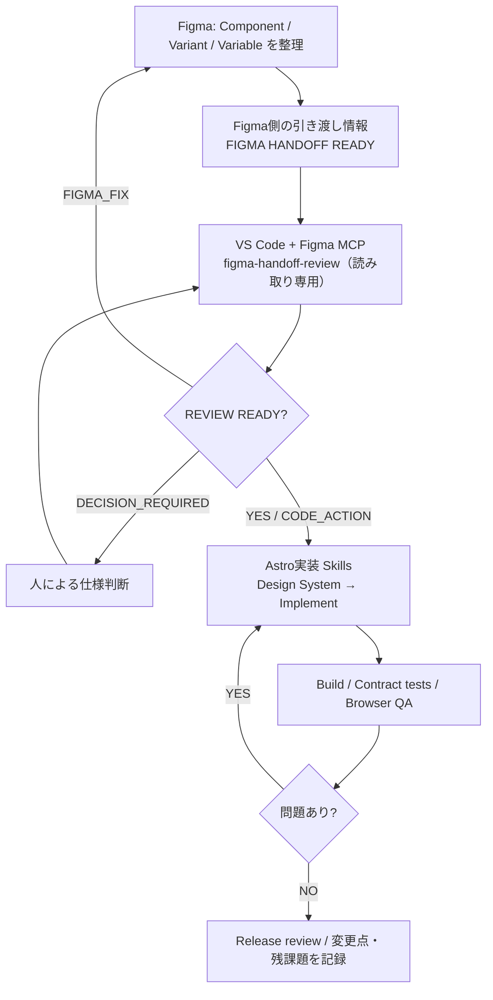

# Figma × Astro × AI Workflow PoC

Figmaのデザイン設計から、AIエージェントを介した実装前レビュー、Astro実装、品質チェックまでをつなぐ**個人制作の検証プロジェクト**です。

> **位置付け**：2026年10月時点の転職用ポートフォリオ・スナップショット。商用案件への導入事例ではありません。AIエージェントによる全工程の完全自動実行を保証するものでもありません。

## 取り組んだ課題

デザインからコーディングへの引き渡しで、コンポーネント・Variant・Token・表示状態の解釈がずれると、実装時の確認や手戻りが増えます。またAIに単発のコード生成を依頼するだけでは、既存部品の再利用や品質検証が抜けやすくなります。

本PoCでは、**設計情報の整理 → 実装前の読み取り専用レビュー → Astro実装 → 自動検査・ブラウザQA** を、それぞれ役割の異なるSkillsと検証ゲートでつなぐ方法を検証しました。

## ワークフロー



**設計側のReadyと、コード側のReadyは別判定です。** Figma側のReadyだけで実装済み・検証済みとは扱いません。Figma MCPが使えない場合は推測で埋めず、未検証として記録します。

## 実装・検証範囲

- Astro 5 + SCSS + TypeScript による静的サイト構成
- 再利用可能な Heading / Button / Card / Media / Section などのUI部品とトークン
- 個人制作の架空ブランド「NAGI STUDIO」を使った2ページの実装パイロット（`/pilot/`, `/pilot/services/`）
- Figmaからの引き渡し情報と既存コードを照合する読み取り専用レビューSkill
- `npm run qa:agent`：Skills構造確認、ビルド、コンポーネント契約テスト、パイロットHTMLテスト
- Playwright/Chromiumを用いたPC・SPのブラウザ確認用スクリプト・GitHub Actions設定

## 試す

Node.js 20.19+ を想定。

```bash
npm ci
npm run qa:agent
npm run dev
```

- `http://localhost:4321/pilot/`
- `http://localhost:4321/pilot/services/`

ブラウザ実機確認用のGitHub Actionsは `.github/workflows/pilot-browser-smoke.yml` を参照してください。

## 主要ファイル

| パス | 役割 |
| --- | --- |
| `figma/agent-skills/` | Figma側の命名・Component・Ready規則 |
| `.github/skills/` | VS Code側の実装前レビュー、実装、QA、完了判定のSkills |
| `src/components/`, `src/pages/pilot/` | 実装例 |
| `tests/`, `scripts/` | 契約テストとQA補助 |
| `docs/portfolio-workflow.md` | 設計・実装・検証の役割分担 |
| `docs/validation-and-limitations.md` | 検証結果と制限事項 |

## 公開範囲

これは**個人制作物の公開用コピー**です。非公開の業務向け監査ツール、社内固有の設定・資料・クライアント情報は含めません。元の開発リポジトリとは履歴を共有しない、独立した公開用スナップショットです。

## 本PoCから示せること

単なるAIコード生成ではなく、役割分担・判断のゲート・既存資産の再利用・品質検証を組み合わせて、再現可能な制作フローを設計したことです。成果の説明では、検証済み範囲と今後の改善課題を分けています。
